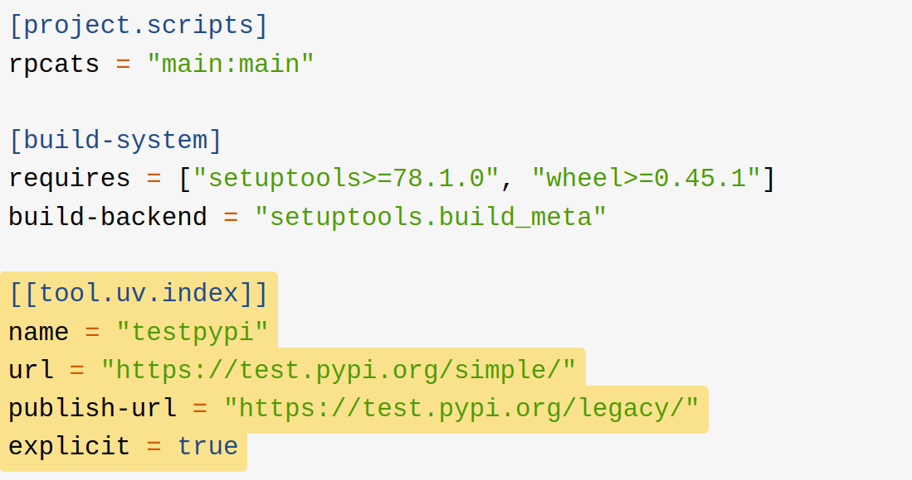

#+AUTHOR: doodo
#+EMAIL: 2901652008@qq.com
#+TITLE: First try on `uv`

* What
uv is a all-in-one python manager(Attention: no package) based on =Rust=

* Common Usage
- uv --version : name explained
- uv self update : check for new version and get it 
- uv add [--dev] [--upgrade] <package> [-r requirements]
- uv upgrade 
- uv remove
- uv pip list/install [-i /source url/ ]
- uv lock/sync
- uv build --sdit/-wheel
- uv publish --index <index> --token <token>
 #+CAPTION: example from realpython.com
 #+ATTR_ORG: width 500px
 

* Command Run
- uvx(alias of uv tool run): it works like **npx**, it basic format is =uvx --from <package-name> <command-name>=, when the two names is same, u can ignore the package name, but when they are different, like [[https://github.com/Textualize/rich-cli][rich]] command in [[https://github.com/Textualize/rich-cli][rich-cli]], u must explicitly point it, =uvx --from rich-cli rich --markdown file.md=.
- =uv run= is a command used to execute python script in a nv managed environment, u can add the =--with= option to ephemerally add a package, which will not be added to **pyproject.toml** actually, u can combine multiple =--with== together, but the better way is =--with-requirements deps.txt=.
- Before introduced way both add command package to a cache under _~/.cache/uv_, if u want to persistently add the command to ur compute instead of current project, use =uv tool install <command-name>=, which installed under _~/.local/bin_, and it won't touch ur **pyproject.toml**.
